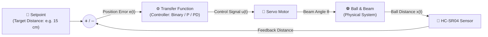
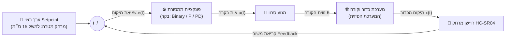

# Ball & Beam Closed-Loop Feedback Control Lab (ESP32)

This repository contains the second step of the Ball and Beam project. Students replace human joystick control with automated **closed-loop feedback control** using an **HC-SR04 Ultrasonic Distance Sensor**.

---

## 1. Closed-Loop System Block Diagram

---

## 2. Hardware Pinout

| Component | ESP32 Pin | Signal Type | Description |
| :--- | :--- | :--- | :--- |
| **HC-SR04 Trigger** | `GPIO 5` | Digital Output | Sends 10µs ultrasonic trigger pulse |
| **HC-SR04 Echo** | `GPIO 18` | Digital Input (Interrupt/Pulse) | Measures pulse return duration |
| **Servo Signal** | `GPIO 13` | PWM Output | Controls beam angle (`0°` to `180°`) |
| **Power** | `5V` & `GND` | Power | Common ground shared by sensor and servo |

---

## 3. Transfer Function / Controller Challenge

Students complete section **4.2 (`TRANSFORM FUNCTION`)** to test three control strategies:

1. **Binary (Bang-Bang) Control (`transferBinary`)**
   * Toggles beam angle between two maximum positions based on setpoint comparison.
   * *Observation:* Causes severe oscillation around setpoint.
2. **Proportional (P) Control (`transferP`)**
   * Adjusts beam angle proportional to position error ($u = K_p \cdot e$).
   * *Observation:* Smooths movement but can overshoot or oscillate without damping.
3. **Proportional-Derivative (PD) Control (`transferPD`)**
   * Combines position error ($K_p$) with velocity/rate-of-change damping ($K_d \cdot \frac{de}{dt}$).
   * *Observation:* Provides stability and rapid settling time.

---

## 4. How to Run

1. Connect the HC-SR04 sensor and servo motor according to the pinout table.
2. Open project in **VS Code** or **Arduino IDE**.
3. Select board: `ESP32 Dev Module`.
4. Select active control strategy in section `4.2`.
5. Open **Serial Plotter** at `115200` baud to observe live tracking of `Setpoint`, `Distance`, and `TargetAngle`.

---

# מעבדת בקרת חוג סגור: מערכת כדור וקורה (ESP32)

מאגר זה מהווה את השלב השני בפרויקט "כדור וקורה". בשלב זה התלמידים מחליפים את השליטה הידנית של הג'ויסטיק ב**בקרת חוג סגור (Closed-Loop Feedback Control)** אוטומטית בעזרת חיישן מרחק אולטרסוני מסוג **HC-SR04**.

---

## 1. תרשים מלבנים של מערכת בחוג סגור

---

## 2. חיווט ופינים (Hardware Pinout)

| רכיב | פין ב-ESP32 | סוג אות | תיאור |
| :--- | :--- | :--- | :--- |
| **HC-SR04 Trigger** | `GPIO 5` | יציאה דיגיטלית | שולח פולס עוררות אולטרסוני של 10µs |
| **HC-SR04 Echo** | `GPIO 18` | כניסה דיגיטלית | מדידת זמן חזרת הפולס |
| **אות סרוו (Signal)** | `GPIO 13` | יציאת PWM | שליטה בזווית הקורה (`0°` עד `180°`) |
| **הזנה (Power)** | `5V` & `GND` | אספקת מתח | הארקה משותפת (Ground) לכל הרכיבים |

---

## 3. אתגר פונקציית התמסורת / הבקר

התלמידים משלימים את חלק **4.2 (`TRANSFORM FUNCTION`)** כדי לחקור ולהשוות 3 שיטות בקרה:

1. **בקרת און-אוף / סף (`transferBinary`)**
   * משנה את זווית הקורה בין שתי זוויות קיצון בהתאם למקום הכדור ביחס לערך הרצוי.
   * *תופעה נצפית:* תנודות קשיחות ואי-יציבות סביב נקודת השיווי משקל.
2. **בקרה פרופורציונלית (`transferP`)**
   * קובעת את זווית ההטיה ביחס ישר לגודל השגיאה ($u = K_p \cdot e$).
   * *תופעה נצפית:* תגובה רציפה וחלקה יותר, אך עשויה לסבול מעובר-שטח (Overshoot) ותנודתיות.
3. **בקרה פרופורציונלית-נגזרת (`transferPD`)**
   * משלבת תיקון לפי גודל השגיאה ($K_p$) יחד עם ריסון לפי מהירות תנועת הכדור ($K_d \cdot \frac{de}{dt}$).
   * *תופעה נצפית:* תגובה יציבה וריסון מהיר של תנודות הכדור.

---

## 4. הוראות הרצה

1. חברו את חיישן ה-HC-SR04 ומנוע הסרוו לפי טבלת הפינים.
2. פתחו את הפרויקט ב-**VS Code** או ב-**Arduino IDE**.
3. בחרו בלוח: `ESP32 Dev Module`.
4. בחרו את פונקציית התמסורת הפעילה בסעיף `4.2`.
5. פתחו את ה-**Serial Plotter** בקצב `115200` baud על מנת לצפות בזמן אמת בגרפים של `Setpoint`, `Distance`, ו-`TargetAngle`.